# WALL-E & EVE's Signal 🤖🌱

**An autonomous agent that searches a simulated, partially observable wasteland for EVE.** It reasons under uncertainty with a Bayesian belief, manages a limited battery and time budget, sees through spoofed signals, and writes a mission report recommending WALL-E's next move. It can also search as a coordinated team (WALL-E + M-O), hand waypoint choice to an LLM, and replay every decision in an interactive viewer.

<p align="center">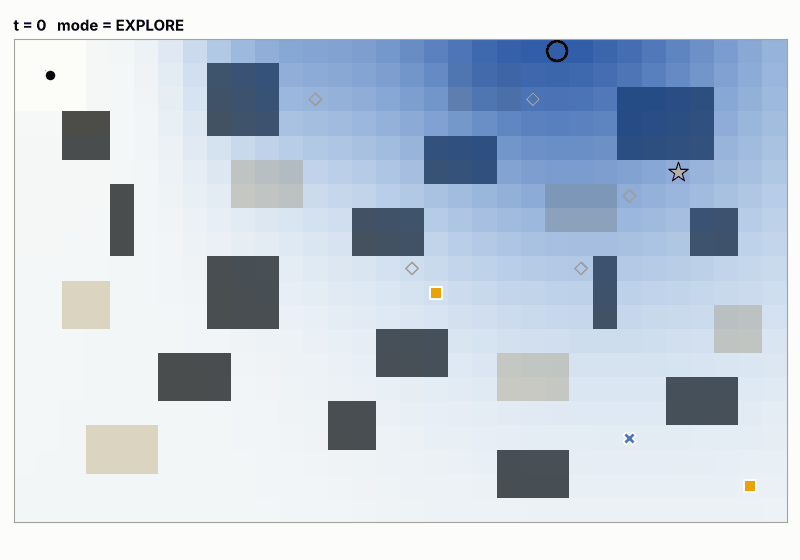</p>

```
python -m walle run configs/sample_mission.yaml --gif
```

| Requirement | Where it lives |
|---|---|
| 1. Simulated environment that loads a config and returns observations per action | [`walle/environment.py`](walle/environment.py), [`walle/config.py`](walle/config.py) |
| 2. Agent that chooses where to move, what to scan, and when to recharge or turn back | [`walle/agents.py`](walle/agents.py) (`BayesianAgent`) |
| 3. Belief updates about EVE's location **and status**; plans adapt to new evidence | [`walle/belief.py`](walle/belief.py), re-planning triggers in `agents.py` |
| 4. Full action trace of actions, observations, decisions and reasoning | `runs/<mission>/trace.jsonl` |
| 5. Final mission report: evidence, inferred location/status, confidence, next step | `runs/<mission>/report.md` + `report.json` |
| Stretch: visualisation of path, clues and strategy changes | ASCII (`final_map.txt`, `--live`), PNG and GIF |
| Advanced: decoy / spoofed signals | Decoy transmitters plus a learned spoof model (decoy-location belief, spoof rate learned online) |
| Advanced: noisy sensors | Noisy strength and bearing, status-dependent dropouts, multipath outliers, missed clues |
| Advanced: generalisation benchmark across random missions | `python -m walle benchmark` → [`benchmarks/`](benchmarks/summary.md) |
| Stretch: UI | Interactive HTML replay (`replay.html`): step slider, belief heat-map, per-step reasoning |
| Advanced: multi-agent coordination | `--robots 2`: robots share one belief and spread out their scans ([results](#multi-robot-search-wall-e--m-o)) |
| Advanced: LLM vs. classical planner | `--agent llm`: Claude chooses among the classical planner's safe waypoints ([details](#5-llm-planner)) |
| Advanced: planner comparison | Bayesian info-gain planner vs. team, naive Bayesian, greedy beacon-follower and random walk |
| Extra: confidence calibration | Reported confidence is checked against outcomes ([calibration](#is-the-reported-confidence-honest)) |

---

## Quick start

```bash
pip install -r requirements.txt            # numpy, pyyaml, matplotlib, pillow (pytest for tests)

python -m walle run configs/sample_mission.yaml            # run, print ASCII map + summary
python -m walle run configs/sample_mission.yaml --gif      # also render an animated GIF
python -m walle run configs/sample_mission.yaml --live     # watch it think in the terminal
python -m walle run configs/sample_mission.yaml --robots 2 # WALL-E + M-O search as a team
python -m walle run configs/sample_mission.yaml --agent llm   # LLM picks waypoints (needs `pip install anthropic` + API key)
python -m walle run configs/decoy_gauntlet.yaml --agent bayesian-naive   # see the decoys win
python -m walle generate --seed 7 --decoys 1 --out configs/my_mission.yaml
python -m walle benchmark --n 25                            # 5 agents x 3 tiers x 25 missions + calibration
python experiments/likelihood_tempering.py                  # calibration ablation
python -m pytest -q
```

Every run writes to `runs/<config-name>[_<agent>][_team<N>]/`:

| File | Contents |
|---|---|
| `trace.jsonl` | One JSON record per step: action, the agent's visible observation, decision + reasoning, belief-update notes, belief summary, and (separately tagged) hidden ground truth for evaluation |
| `report.md` / `report.json` | The mission report |
| `final_map.txt` | ASCII map of the path, clues and decoys, plus an ASCII heat-map of the final belief |
| `mission.png` | Path coloured by strategy mode, scans, clues found/missed, decoys, labelled strategy changes, and four belief snapshots over time |
| `timeline.png` | Mode, battery, belief entropy and localisation confidence over time |
| `replay.html` | **Interactive replay**: open in any browser (no server, no internet). Step through every decision with the map, belief heat-map, signal bearings, reasoning and evidence. Add `#step=40&truth` to the URL to jump to a step and reveal the hidden truth |
| `mission.gif` | Animated search (with `--gif`) |
| `llm_decisions.jsonl` | LLM planner only: every prompt, choice and rationale (or the fallback reason) |

Committed sample outputs: [`runs/sample_mission`](runs/sample_mission/report.md), [`runs/decoy_gauntlet`](runs/decoy_gauntlet/report.md) (and the [naive agent failing it](runs/decoy_gauntlet_bayesian-naive/report.md)), [`runs/generated_seed42`](runs/generated_seed42/report.md), [`runs/random_stub`](runs/random_stub/report.md), the [greedy baseline on the sample mission](runs/sample_mission_greedy/report.md), and team runs [`runs/sample_mission_team2`](runs/sample_mission_team2/report.md) and [`runs/decoy_gauntlet_team2`](runs/decoy_gauntlet_team2/report.md). Every run folder has a `replay.html`.

<p align="center">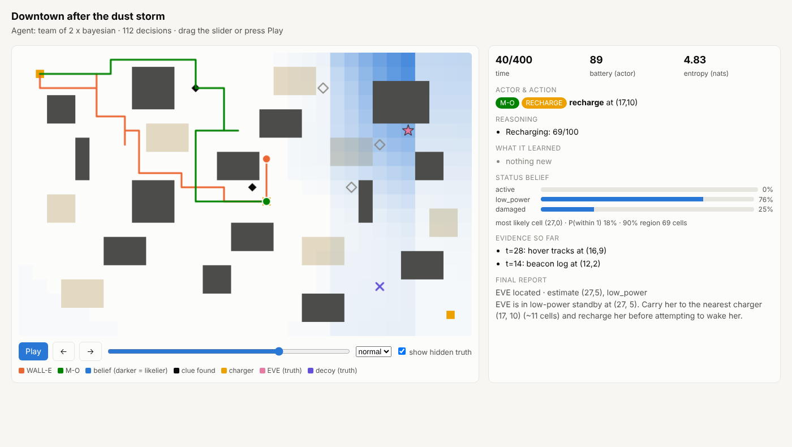</p>

## Architecture

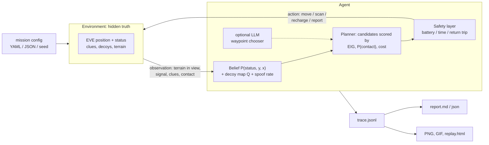

Each loop iteration: the agent (or, in a team, whichever robot is earliest on its own clock) decides an action, the environment applies it and returns only what the robot could physically sense, and the agent folds that into its belief. Every decision is logged together with its reasoning.

---

## Environment design

The world is a 2-D grid (x grows east, y grows south) of **open ground** `.`, **walls / collapsed buildings** `#`, **rubble** `~` (3× the battery and 2× the time to cross) and **charging stations** `C`. WALL-E starts at his truck `S`, which is also a charger.

**Hidden state (the agent never reads it):** EVE's position, EVE's status (`active`, `low_power` or `damaged`), clue locations and contents, and decoy transmitters.

**Partial observability.** WALL-E starts with no map. Each step he sees terrain within `sight_radius` cells. Charger locations are known in advance (infrastructure).

**Actions and costs** (all set in the config):

| Action | Battery | Time | Effect |
|---|---|---|---|
| `move N/S/E/W` | `move` (open) / `move_rubble` | 1 / 2 | Fails and costs `blocked` if the cell is a wall |
| `scan` | `scan` | 1 | Signal reading, plus clue detection within `scan_radius` (each clue found with prob. `clue_detect_prob`) |
| `recharge` | gains `recharge_rate` | 1 | Only works on a charger |
| `report` | 0 | 0 | Ends the mission |

The mission ends on `report`, when the time budget runs out, or when WALL-E is **stranded** (battery hits 0 away from a charger).

### Sensor models ([`walle/sensors.py`](walle/sensors.py))

**EVE's beacon.** Expected strength falls off with distance: `mu = power[status] − 15·log2(1+d)`. A reading is `mu + N(0, sigma[status])`; below the noise floor it reads as *no signal*. The bearing has Gaussian noise plus 5% multipath outliers (uniformly random bearings).

| status | power | strength noise | dropout | bearing noise |
|---|---|---|---|---|
| active | 80 | 3 | 3% | 10° |
| low_power | 64 | 4 | 20% | 14° |
| damaged | 74 | 9 (erratic) | 35% | 24° |

Status and distance are confounded: a weak reading could mean "far away" or "close but failing". That is why the belief is over *(position, status)* jointly.

**Decoys.** Spoofing transmitters capture a scan with probability `rate`. They transmit like a healthy EVE from their own location. Every detected packet also carries a noisy **authentication score** (genuine ≈ N(0.72, 0.15), spoofed ≈ N(0.40, 0.15)). The two distributions overlap heavily, so the score is weak evidence on its own.

**Clues.** Clues can only be discovered by scanning near them. Their content is generated from the hidden truth, with noise:

| type | observation | status evidence (likelihood ratio active / low_power / damaged) |
|---|---|---|
| `hover_tracks` | Noisy bearing from the clue towards EVE | 1.6 / 0.9 / 0.6 |
| `debris` | "EVE is within R cells" | 0.5 / 0.8 / **2.5** |
| `power_cell` | "EVE is within R cells" | 0.6 / **2.5** / 1.0 |
| `beacon_log` | EVE's x or y lies in a 6-cell range | neutral |
| `plant` | "EVE is within R ≤ 4 cells" (strong) | 1.3 / 1.0 / 0.9 |

**Visual contact.** When WALL-E is within `contact_radius` of EVE he sees her, and her status is read correctly 95% of the time. Every step *without* contact is negative evidence: EVE is not next to WALL-E.

---

## The agent

### 1. Belief ([`walle/belief.py`](walle/belief.py))

A discrete joint posterior `P[status, y, x]`, updated by Bayes' rule after every observation:

* **Signal readings** use the full strength and bearing likelihood. *No signal* is also evidence: it says EVE is far away, or failing.
* **Clues** carry a spatial likelihood (bearing cone, distance disk, or coordinate band) multiplied by the status likelihood ratios.
* **Walls** that WALL-E sees are removed from the hypothesis space. Not seeing EVE rules out nearby cells.
* **Stale initial reading.** Its noise is widened according to its age (`timestamp`). An optional rough coordinate fix becomes a Gaussian prior.
* **Robustness.** A small uniform floor stops the belief from ever becoming certain of something wrong.

**Spoof-aware filtering** (Advanced: decoys). Each detected reading is modelled as a mixture:

```
p(z) = (1-ε) · p_EVE(z | P) + ε · [0.7 · p_decoy(z | Q) + 0.3 · uniform]
```

* `Q` is a second belief grid over *where a decoy transmitter is*.
* `ε` is the spoof rate. It is **learned online**: a Beta posterior updated with each reading's spoof responsibility (soft EM).
* `P` and `Q` are updated with the other hypothesis marginalised out (an assumed-density filter).

Once the decoy has been localised, its readings are *explained away* instead of dragging the belief off course. At the end, every reading is re-scored against the final belief, and those flagged in hindsight are listed in the report.

### 2. Planner ([`walle/agents.py`](walle/agents.py) `BayesianAgent`, [`walle/planning.py`](walle/planning.py))

At each re-plan the agent samples about 40 candidate waypoints: belief hot-spots, posterior samples and unexplored cells. It scores each one:

```
utility = ( w_info·EIG(scan there) + w_contact·P(EVE within 1 cell) + w_clue·unexplored fraction )
          ---------------------------------------------------------------------------------------
                                path cost (battery) + scan cost + offset
```

* **EIG** is the Monte-Carlo expected entropy reduction from scanning at that cell. Hypothetical readings are simulated from the current belief.
* **Path costs** come from Dijkstra over the *partial* map. Unknown cells are costed optimistically when exploring and conservatively when computing the trip home.
* WALL-E walks to the best feasible waypoint, scans on arrival, and also scans on the way when the EIG at his current cell is high enough.

**Re-planning triggers** (strategy changes, logged with their reason): reached the waypoint, route blocked by a newly seen wall (he reroutes and keeps the target if it is still valid), a new clue, or a belief shift (KL divergence) above `replan_kl` nats since the plan was made.

### 3. Resource management: when to recharge or turn back

A waypoint is **feasible** only if `battery ≥ path + scan + return-to-nearest-charger + safety_margin`, and the time budget also allows the return trip. Hard rules, shared by every agent:

* **RECHARGE.** If the battery would not cover the worst next step plus the trip home plus the reserve, go to the nearest charger and charge to full.
* **Recharge first.** If the best target is out of range on the current battery but reachable from a full one (and clearly better than any reachable target), go recharge first.
* **TURN_BACK.** If the remaining time is close to the time needed to get home, head back and report.
* **Report.** On visual contact, or when nothing worthwhile is reachable, transmit the report.

Modes are `EXPLORE` (belief diffuse), `PURSUE` (target has P(EVE nearby) > 0.25), `RECHARGE` and `TURN_BACK`. They colour the path in every visualisation.

### 4. Multi-robot coordination (`--robots N`)

WALL-E and his teammates (M-O, BURN-E, ...) share **one** belief, map and evidence log (perfect communication is assumed). Each robot runs the same planner on its own battery and clock. Two things coordinate them:

* **Shared evidence.** Any robot's reading, clue or wall sighting updates the team belief, and the resulting belief shift can trigger re-plans in *every* robot.
* **Spreading out.** When scoring a candidate, the exploration value is discounted by `1 − 0.8·exp(−(d / 2r)²)`, where `d` is the distance to the nearest teammate's current target and `r` the scan radius. Robots therefore spread their scans instead of duplicating them, while still allowed to converge when EVE is almost certainly in one place.

The environment is event-driven: the robot that is earliest on its own clock acts next, so rubble (2 time units) and recharging interleave correctly. Any robot's visual contact ends the mission for the team.

### 5. LLM planner

`--agent llm` keeps the whole classical pipeline: belief, candidate generation, feasibility filtering and safety rules. It replaces only the final choice among the **top 8 feasible waypoints**:

* The LLM receives a plain-language situation report (position, battery, time, belief summary, status belief, learned spoof rate, clues) and the candidates with their path cost, return cost, P(contact), EIG and classical utility.
* It answers in a fixed JSON schema (`{"choice": int, "reasoning": str}`), enforced with structured outputs. The default model is `claude-opus-5-5` at low effort, with server-side refusal fallback enabled.
* The LLM can only pick among options that are already safe, so it **can never strand the robot**. Any API error, refusal, out-of-range answer or missing `anthropic` package falls back to the classical choice, and the reason is logged.
* Every prompt and rationale is saved to `llm_decisions.jsonl`, so LLM and classical decisions can be compared directly.

The test suite checks both paths with a mock client (choice honoured and schema requested; failure falls back safely). Benchmarking it for real needs an API key: `python -m walle benchmark --agents bayesian,llm --n 10`. No LLM numbers are reported here because this environment has no key.

### 6. Baselines (for comparison)

* `bayesian-naive`: the same planner without the spoof model (ε = 0). This is an ablation.
* `greedy`: scans every 3 steps and walks along the last bearing heard. This is the classic beacon-follower.
* `random`: random walk with periodic scans.

All agents share the same perception and safety rules, so differences in the benchmark come from the decision policy.

---

## Results

### Sample mission ([full report](runs/sample_mission/report.md))

<p align="center">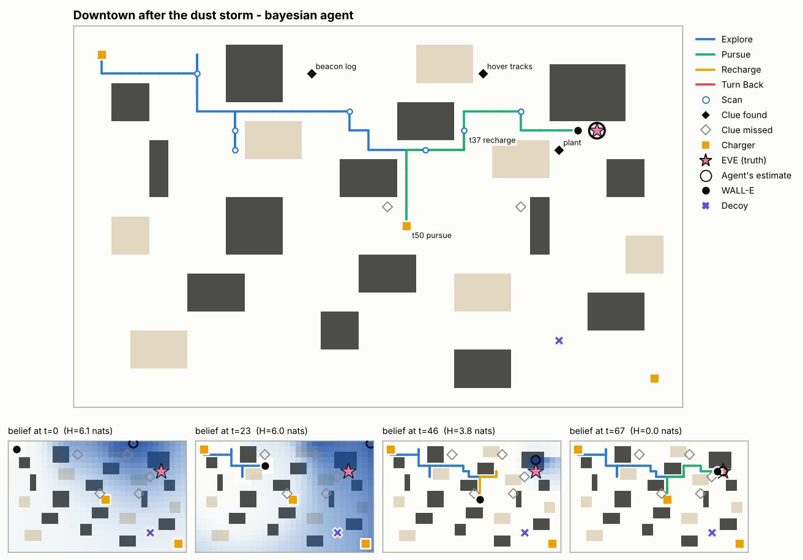</p>

What happens in this run:

1. WALL-E finds a beacon-log fragment (t=26) that pins EVE's y-coordinate to [3, 8].
2. He sees that his best target, (28, 4), is out of range on 27 battery, so he recharges at the mid-map station (t=37–50) and then switches to PURSUE.
3. At t=63 one scan turns up two clues: a seedling in a boot ("EVE within 4 cells") and hover tracks pointing east-south-east.
4. Meanwhile the Buy-n-Large billboard keeps spoofing EVE's handshake. All **3 of 3** decoy readings are flagged and down-weighted, with **0** genuine readings wrongly flagged. He places the decoy transmitter near (27, 19); its true position is (25, 16).
5. He reaches EVE at t=67 and reports her as `low_power`, which matches the truth.

His recommendation is to carry EVE to the nearest charger before trying to wake her.

<p align="center">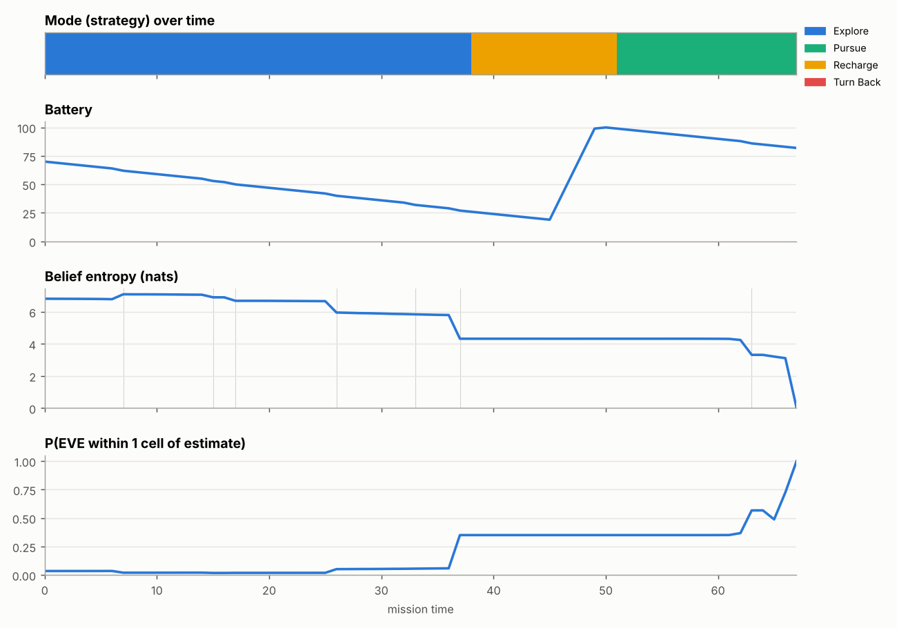</p>

### Decoy gauntlet: the spoof model matters

Two strong decoys next to the truck capture about 60% of all scans.

| Bayesian (spoof-aware) - finds EVE at t=77 | Naive Bayesian - chases decoys until time runs out (t=391) |
|---|---|
| 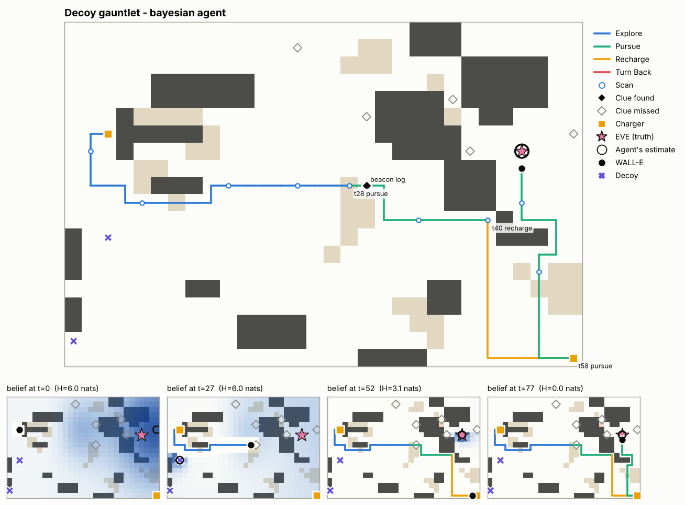 | 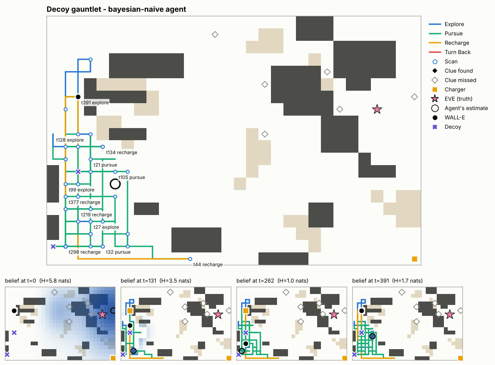 |

### Generalisation benchmark ([`benchmarks/summary.md`](benchmarks/summary.md))

| tier | agent | EVE found | median loc. error | status acc. | time to find | battery used | stranded |
|---|---|---|---|---|---|---|---|
| standard | **bayesian** | **100%** | 0.0 | 100% | 63.2 | 70.0 | 0% |
| standard | bayesian@2 | 100% | 0.0 | 100% | 51.2 | 111.0 | 0% |
| standard | bayesian-naive | 100% | 0.0 | 100% | 63.7 | 70.2 | 0% |
| standard | greedy | 72% | 0.0 | 100% | 122.3 | 233.9 | 0% |
| standard | random | 0% | 1.41 | 100% | - | 450.6 | 0% |
| decoys | **bayesian** | **100%** | 0.0 | 96% | 92.7 | 101.4 | 0% |
| decoys | bayesian@2 | 100% | 0.0 | 100% | 70.6 | 151.9 | 0% |
| decoys | bayesian-naive | 64% | 0.0 | 32% | 167.3 | 249.1 | 4% |
| decoys | greedy | 16% | 1.0 | 96% | 187.2 | 421.4 | 0% |
| decoys | random | 0% | 2.83 | 84% | - | 450.6 | 0% |
| harsh | **bayesian** | **100%** | 0.0 | 100% | 105.5 | 111.8 | 0% |
| harsh | bayesian@2 | 100% | 0.0 | 100% | 76.1 | 157.8 | 0% |
| harsh | bayesian-naive | 76% | 0.0 | 64% | 124.1 | 177.0 | 4% |
| harsh | greedy | 24% | 1.0 | 100% | 151.2 | 347.5 | 0% |
| harsh | random | 0% | 2.83 | 100% | - | 393.1 | 0% |

Takeaways:

* **The spoof-aware Bayesian agent found EVE in all 75 missions and never stranded.** Removing the spoof model (`bayesian-naive`) drops success to 64% (decoys) and 76% (harsh), more than doubles battery use, and makes status inference unreliable (32% in the decoys tier), because decoy readings look like a healthy EVE. The naive agent also stranded in one decoys mission and one harsh mission.
* **Two coordinated robots find EVE 19%–28% sooner** (`bayesian@2`) at 100% success. The team spends more *total* battery (two robots), but the mission clock, which is what matters to EVE, is shorter.
* **Planning matters as well as inference.** Every agent has the same belief, but greedy beacon-following succeeds only 16–72% of the time and uses 3–4× the battery, and random search never makes contact.
* **"Status acc." for agents that never found EVE is not a leak.** Status is inferred from signal statistics (dropout rate, noise) over many scans. With status-identical sensors the random agent's status accuracy falls to chance level (6/12 vs. 12/12).

<p align="center">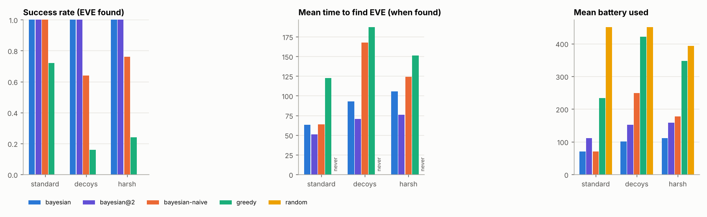</p>

Tiers:

* **standard:** 30×20 map, 6 clues, no decoys.
* **decoys:** as standard, plus 2 decoys, each capturing a scan 40% of the time.
* **harsh:** 36×24 map, 4 clues, 1 decoy, 60 starting battery, 350 time.

Missions are procedurally generated from seeds, and every agent sees exactly the same missions.

### Multi-robot search (WALL-E + M-O)

On the sample mission the team reaches EVE at **t=56** instead of t=67. On the decoy gauntlet it reaches her at **t=69** instead of t=77, with all 6 of 6 decoy readings flagged. Both robots keep searching and recharge independently.

| Sample mission, team of 2 | Decoy gauntlet, team of 2 |
|---|---|
| 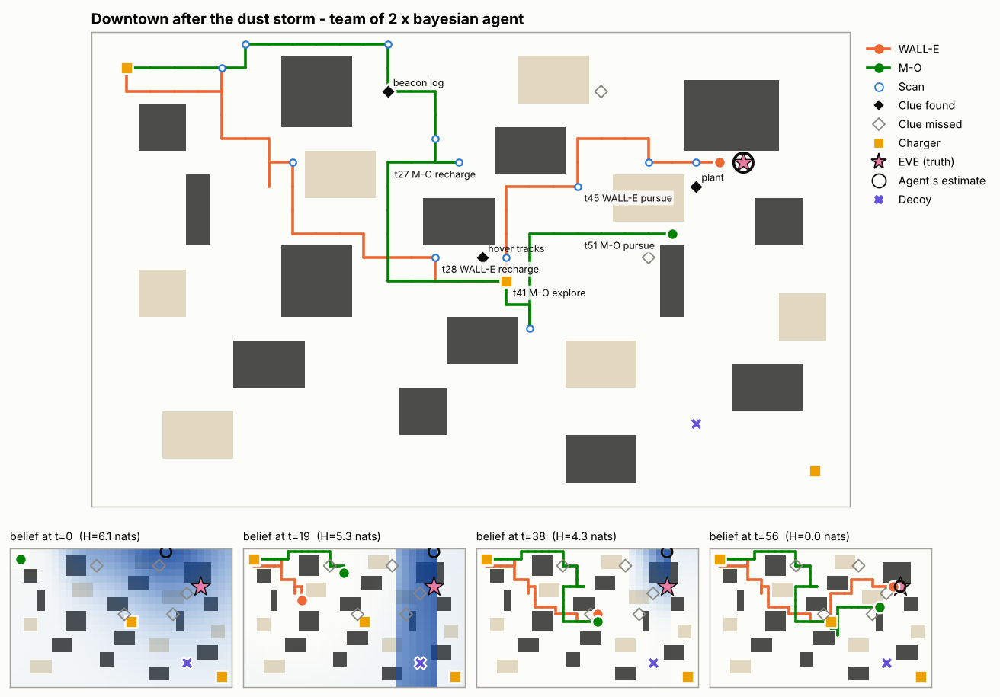 | 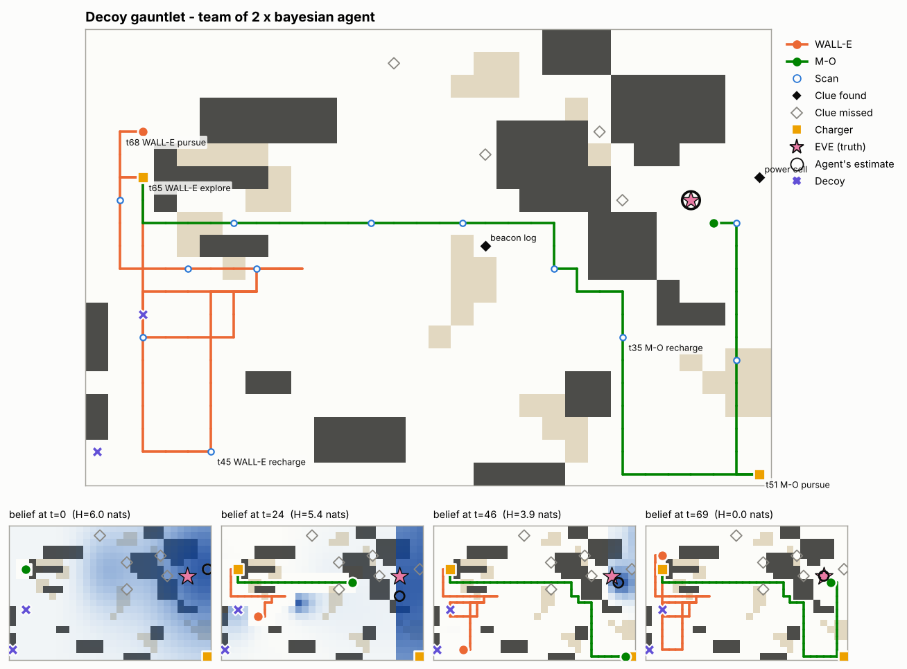 |

### Is the reported confidence honest?

The report states a confidence, P(EVE within 1 cell of the estimate). To test it, 100 extra missions are given only 60 time units, so many end **before** contact and the agent must report an estimate. Over the 87 missions that ended without contact:

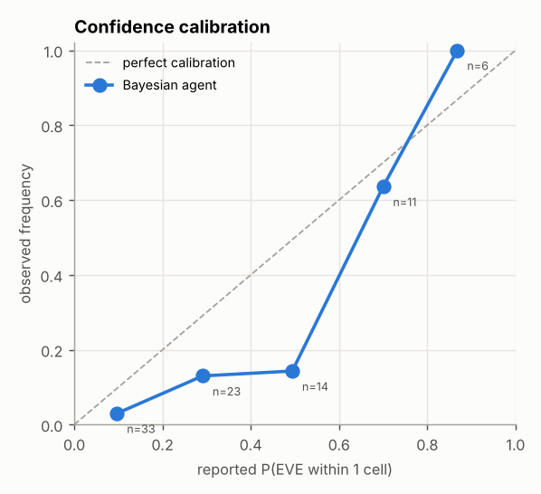

| reported P | missions | mean reported | observed hit rate |
|---|---|---|---|
| 0.0-0.2 | 33 | 0.10 | 0.03 |
| 0.2-0.4 | 23 | 0.29 | 0.13 |
| 0.4-0.6 | 14 | 0.49 | 0.14 |
| 0.6-0.8 | 11 | 0.70 | 0.64 |
| 0.8-1.0 | 6 | 0.87 | 1.00 |

The Brier score is **0.1192** (0 is perfect). High-confidence reports (≥ 0.6) are reliable. In the middle range the agent is somewhat over-confident on these seeds.

**Ablation: likelihood tempering.** A standard fix for over-confident filters is to temper each signal likelihood (`L^τ`, `agent.likelihood_temper`), because successive readings share errors (multipath, decoys, model mismatch). [`experiments/likelihood_tempering.py`](experiments/likelihood_tempering.py) tests it on 100 **held-out** seeds:

| tau | missions | Brier | mean reported P | observed hit rate | mid-range (0.2-0.8) reported | mid-range observed | success | mean time |
|---|---|---|---|---|---|---|---|---|
| 1.0 | 87 | 0.1457 | 0.344 | 0.310 | 0.45 | 0.38 | 100% | 88 |
| 0.7 | 88 | 0.1633 | 0.256 | 0.295 | 0.44 | 0.41 | 100% | 77 |
| 0.5 | 94 | 0.1429 | 0.226 | 0.277 | 0.43 | 0.53 | 100% | 102 |
| 0.35 | 92 | 0.1795 | 0.175 | 0.337 | 0.36 | 0.65 | 100% | 103 |

τ = 1 is already about as well calibrated overall as any tempered setting on held-out data. Stronger tempering turns the agent *under*-confident without improving the Brier score, so the default stays τ = 1. The over-confidence in the benchmark's middle bin is mostly small-sample noise (14 missions).
<br clear="right">

---

## Config format

Configs are YAML or JSON. [`configs/sample_mission.yaml`](configs/sample_mission.yaml) is fully commented. Everything except `map` (or `generate`) and `eve` has a default.

```yaml
mission:   {name: str, seed: int}          # seed drives all simulator randomness
map:
  layout: |                                # rows of . # ~ C S  (optional E = EVE, D = decoy)
    S....
    .##~.
start: [x, y]                              # optional if 'S' is in the layout
eve:   {position: [x, y], status: active | low_power | damaged}   # ground truth
initial_signal:                            # the ping that started the mission
  bearing_deg: 80                          # compass, 0=N 90=E (optional)
  strength: 12.5                           # (optional)
  timestamp: -20                           # <=0, age widens the noise
  coordinates: [x, y]                      # optional rough fix ...
  uncertainty: 6                           # ... and its radius in cells
  # omit initial_signal entirely to have the simulator sample one
resources:
  battery_capacity: 100
  initial_battery: 80
  time_budget: 400
  costs: {move: 1, move_rubble: 3, scan: 2, recharge_rate: 20, blocked: 0.5}
sensors:
  sight_radius: 2
  scan_radius: 3
  clue_detect_prob: 0.85
  contact_radius: 1
  contact_status_accuracy: 0.95
  signal: {noise_floor: 8, path_loss: 15, power: {low_power: 60}, ...}   # override any SignalModel field
clues:                                     # positions + types; contents come from the truth
  - {id: tracks-1, type: hover_tracks, position: [16, 9]}
decoys:
  - {position: [25, 16], power: 74, rate: 0.35}
agent:                                     # BayesianAgent hyper-parameters (optional)
  safety_margin: 6
  spoof_prior: 0.15
  w_info: 1.0
  w_contact: 4.0
  w_clue: 0.6
  replan_kl: 0.4
```

**Procedural missions.** Give a `generate:` block instead of `map` (see [`configs/random_stub.yaml`](configs/random_stub.yaml)). Any explicit key overrides the generated value. `python -m walle generate --seed N --out file.yaml` writes the full expanded config so it can be inspected and edited.

The generator:

* places collapsed buildings and rubble fields,
* seals off unreachable pockets,
* puts EVE far from the start, with extra chargers spread out,
* samples clue *types* according to EVE's hidden status, so clue types carry honest status evidence,
* adds decoys away from EVE,
* and samples the initial stale reading.

## Trace format

`trace.jsonl` has one JSON object per line:

* a `mission_start` record (mission info, initial-signal notes, prior belief summary),
* one `step` record per action,
* a `mission_end` record (outcome, inference, recommendation, ground truth).

```json
{"type": "step", "step": 0, "t": 1, "mode": "EXPLORE",
 "action": {"type": "move", "dir": "S"},
 "decision": {"mode": "EXPLORE", "target": [12, 2],
   "reasoning": ["Replan (initial plan): target (12,2) - EIG 2.52 nats, P(EVE within 1)=0.03, path cost 14.7, return cost 20.0, utility 0.156 (best of 33 feasible; runner-up (14,2) 0.139)"],
   "strategy_change": null},
 "observation": {"t": 1, "position": [1, 2], "battery": 69.0, "contact": null, "...": "..."},
 "belief_update_notes": [],
 "belief": {"map_cell": [22, 0], "map_prob": 0.0061, "p_within_1": 0.0354, "entropy": 6.812,
            "cred90_cells": 377, "status": {"active": 0.611, "low_power": 0.198, "damaged": 0.191}},
 "hidden_truth": null}
```

`hidden_truth` records the simulator's own view (for example, whether a reading came from a decoy). It is never shown to the agent and is used only for evaluation.

## Project layout

```
walle/
  config.py        config loading/validation + procedural mission generator
  sensors.py       signal / auth / clue models (shared by simulator and agent)
  environment.py   the simulator: hidden truth -> observations
  belief.py        joint (position x status) Bayesian filter + spoof/decoy model + EIG
  planning.py      Dijkstra over the partial map
  agents.py        BayesianAgent (ours), LLMPlannerAgent, Team + naive / greedy / random baselines
  report.py        mission report (JSON + Markdown)
  viz.py           ASCII, PNG and GIF rendering
  replay.py        self-contained interactive HTML replay
  runner.py        env <-> agent(s) loop (single robot or team), trace logging
  benchmark.py     multi-agent, multi-tier generalisation benchmark
  cli.py           `python -m walle ...`
configs/           sample missions (YAML + JSON)
runs/              committed traces, reports and visualisations
benchmarks/        benchmark CSV, summary, charts, calibration + tempering ablation
experiments/       reproducible ablation scripts
tests/             pytest suite (incl. mocked LLM planner)
.github/workflows/ CI: tests + smoke runs on Python 3.10 and 3.12
```

## Limitations and future work

* **EVE is stationary.** A drifting EVE would need a motion model, i.e. a prediction step in the filter.
* **The planner is one-step greedy over waypoints.** It is not a full POMDP solver. Multi-step lookahead (e.g. POMCP) could plan better scan sequences.
* **Team communication is perfect.** Real robots would need range-limited, delayed messaging and belief merging.
* **LLM planner results need an API key.** The hook, prompts, schema and fallbacks are implemented and tested with a mock client. Running `--agents bayesian,llm` with a key fills in the comparison.
* **Mid-range confidence is somewhat over-confident** on the benchmark seeds (see calibration). Post-hoc isotonic calibration fitted on held-out missions is a natural next step.
* **Physics simulation.** The grid could be swapped for a Webots/Gazebo world through the same observation and action interface.
